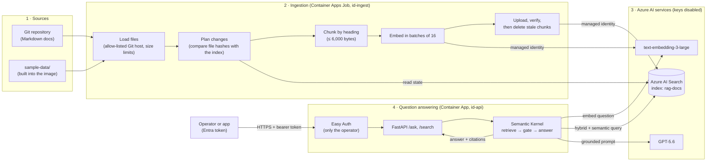

# Azure RAG Example

## Overview

**What it is.** A small, working question-answering service over your own documents. A scheduled Python job reads a Git repository, splits files into passages, turns each passage into a vector and stores it in Azure AI Search. An API on Azure Container Apps takes a question, finds the best passages and asks GPT-5.6 to answer using only those passages, with citations. Ask an AI assistant to search this folder for details; the guides below cover each stage.

**Stand it up** (about 20 minutes, from `deployment/` in PowerShell 7): sign in with `az login`, select or create the `rag-poc` azd environment, run `azd up`, then start the ingestion job once to seed the index. The exact commands are in [Deploy and Remove](#deploy-and-remove).

**Tear it down:** run `azd down --purge` from `deployment/`. It deletes the resource group and purges the soft-deleted AI Services account. If you created the optional API app registration, delete it as well.

### Estimated Monthly Cost

These are **US list prices (pay-as-you-go, USD) without enterprise discounts**, so they reflect what a team outside Microsoft would pay. Prices come from the Azure Retail Prices API; sizes and limits come from Microsoft Learn. Tax, support plans, Microsoft Defender for Cloud and internet egress are excluded. Check the [Azure pricing calculator](https://azure.microsoft.com/pricing/calculator/) before you commit to a budget.

**Assumptions**

- The search index holds **about 10 GB** built from a large repository. With 3,072-dimension vectors (about 12 KB each) and passages of up to 6 KB, that is roughly 450,000 passages: about 6 GB of vectors and 2 GB of text.
- A full embedding pass is **about 500–800 million tokens** (code and Markdown tokenize densely).
- **200–300 questions a day** (6,000–9,000 a month). Each answer sends about 8,500 input tokens (five passages plus instructions) and returns about 1,000 output tokens, including reasoning.
- **Weekly re-index with `update` mode.** The job already re-embeds only files whose content changed and removes deleted files. We assume **about 5% of the content changes each week** (25–40 million tokens per run). The full `seed` pass runs once, and again only after a chunking or embedding-model change.

| Azure Service | Existing Deployment | Production Deployment |
| --- | --- | --- |
| Azure AI Search | Basic, 1 replica × 1 partition: **$74**. Too small for 10 GB (see below) | S1, 2–3 replicas × 1 partition: **$490–$736** |
| Semantic ranker | Free plan: **$0**, but only 1,000 requests a month (runs out in about 4 days) | Standard plan, first 1,000 free, then $1 per 1,000: **~$8** |
| GPT-5.6 `sol` answers | Global Standard ($4 / $20 per million input / output tokens): **$325–$490** | Data Zone Standard, US data residency (+10%): **$355–$535** |
| Embeddings, weekly `update` | Global ($0.13 per million tokens), about 4.3 runs a month: **$15–$25** | Data Zone ($0.143 per million): **$15–$30** |
| Embeddings, first `seed` (one time) | **$65–$105** once | **$72–$115** once (repeat after a model or chunking change) |
| Container Apps API | 0.5 vCPU / 1 GiB, scales to zero; mostly inside the monthly free grant: **$0–$15** | 1 vCPU / 2 GiB, minimum 2 replicas always on: **$75–$160** |
| Container Apps ingestion job | 1 vCPU / 2 GiB, inside the free grant: **$0–$5** | 2 vCPU / 4 GiB, weekly runs of 1–2 hours: **$1–$5** |
| Container Registry | Basic: **$5** | Premium (needed for private endpoints): **$50** |
| Log Analytics and Application Insights | 1–3 GB a month, within the first 5 GB free: **$0–$5** | 5–15 GB a month at $2.76 per GB: **$15–$45** |
| Networking | VNet and network security group, public service endpoints: **$0** | Private endpoints for Search, AI Services and Registry plus private DNS zones: **$25–$35** |
| API gateway (optional) | None: **$0** | API Management Basic v2 ($150) or Standard v2 for VNet integration ($700): **$150–$700** |
| **Monthly total** | **~$420–$620** as deployed. **~$500–$700** after two minimum fixes: a second Search partition (+$74) and the Standard semantic ranker plan (+$8) | **~$1,050–$1,600** without a gateway. **~$1,200–$2,300** with one |

The language model and Azure AI Search together are about 80–95% of the bill. Embedding costs stay small because the weekly `update` only re-embeds changed files. A weekly full `seed` would raise embeddings to about $280–$500 a month.

### Proof of Concept vs Production

The deployed proof of concept uses the cheapest options that prove the design works. It is not sized for a 10 GB index. What changes for production, and why:

| Area | Proof of concept choice | What production needs |
| --- | --- | --- |
| Search capacity | Basic with one partition, which holds 5 GB of vectors | About 6 GB of vectors does not fit. **Minimum fix:** add a second Basic partition (+$74) or turn on int8 scalar quantization. **Production:** S1 (35 GB of vectors per partition) |
| Search availability | One replica, no service-level agreement | 2 replicas for a query SLA; 3 replicas for a read-write SLA while the weekly job writes |
| Semantic ranker | `free` plan | **Minimum fix:** switch to the Standard plan (~$8). The app refuses to answer when the ranker score is missing, so running out of free requests stops answers |
| Model deployments | Global Standard (any Azure region may process the request) | Data Zone Standard if prompts and documents must stay in the US. Provisioned throughput is not cost-effective at 300 questions a day |
| Re-index throughput | 120,000 tokens a minute and a 1-hour job timeout: the first 10 GB seed would take about 80 hours, and even a 5% update needs 3–6 hours | Raise the embedding quota to about 1 million tokens a minute (a quota request may be needed) and raise the job's `replicaTimeout` to cover the seed (about 10 hours) |
| Index state | The job reads current index state from Search, capped at 100,000 passages | About 450,000 passages need a different state store, such as a blob manifest or a table (under $1 a month) |
| Schedule | Daily cron `0 6 * * *`, off until `ENABLE_INGEST_SCHEDULE=true` | Change `ingestCron` in `main.bicep` to weekly, for example `0 6 * * 0` (Sundays 06:00 UTC), during low query traffic |
| API hosting | Scales to zero; the first question after idle waits for a cold start | At least 2 replicas across availability zones |
| Network | Public service endpoints protected by Microsoft Entra ID and role assignments | Private endpoints, a Premium registry, and an optional API Management gateway for quotas and client keys |

**Ways to cut cost:** use a smaller model such as `gpt-5.6-luna` (about 20 times cheaper per token) or `gpt-5.6-terra` (about half) for routine questions; send three passages instead of five; cache answers to repeated questions; use `text-embedding-3-small` or fewer dimensions with quantization to stay on Basic search.

This folder holds a complete, working example of a retrieval-augmented generation (RAG) system on Azure. It answers questions from your own documents and cites the passages it used. When the documents do not contain the answer, it says so instead of guessing.

It includes sample data, Python code, Bicep infrastructure, an Azure Developer CLI (azd) deployment and step-by-step guides. **A proof of concept is deployed in resource group `<resource-group>`** (see [REPORT.md](REPORT.md#deployment-status)). To deploy your own, follow [deployment/README.md](deployment/README.md).

| Building block | Choice |
| --- | --- |
| Vector database | Azure AI Search (hybrid keyword and vector search, plus the semantic ranker) |
| Embedding model | Azure OpenAI `text-embedding-3-large` (3,072 dimensions) |
| Language model | GPT-5.6 (`gpt-5.6-sol`) in Azure AI Foundry |
| Document ingestion | Python, run as an Azure Container Apps Job |
| Orchestration | Semantic Kernel (Python) |
| Hosting | Azure Container Apps (API) and Container Apps Jobs (ingestion) |
| Target | Resource group `<resource-group>` in subscription `<subscription-id>` |

No keys, passwords or connection secrets are used anywhere. Services reach each other with **managed identities**. The only person who can use the system is **you**, the operator who deploys it. See [SECURITY-REVIEW.md](SECURITY-REVIEW.md).

## How the System Works



1. **Sources.** Markdown documents come from the bundled `sample-data/` folder or from a Git repository you choose.
2. **Ingestion.** The job reads every file and compares each file's hash with what is already in the index. Only new or changed files are chunked and embedded. New chunks are uploaded and checked before old ones are deleted, so a failed run never leaves the index emptier than before.
3. **Azure AI services.** AI Search stores the text and vectors. The embedding model turns text into vectors. GPT-5.6 writes answers.
4. **Question answering.** The API embeds the question and runs a hybrid search (keywords plus vectors) re-ranked by the semantic ranker. If the best passage scores too low, it answers "not found" without calling GPT-5.6. Otherwise GPT-5.6 answers in JSON, and every sentence must cite a passage. Answers that fail that check become "not found".

## Folder Map

| Folder | What it contains |
| --- | --- |
| [sample-data/](sample-data/README.md) | A small fictional corpus (Contoso Fleet Telemetry) used for the first seed |
| [src/](src/README.md) | The Python application: ingestion, retrieval, answering, the API, tests and a client example |
| [deployment/](deployment/README.md) | `azure.yaml`, Bicep infrastructure, the search index definition and helper scripts |
| [howto/](howto/README.md) | Task guides: seed, update, query, consume, operate and troubleshoot |
| [REPORT.md](REPORT.md) | The all-up report: every stage defined and explained |
| [SECURITY-REVIEW.md](SECURITY-REVIEW.md) | Identity model, threat review and the security rubber-duck results |
| [review.md](review.md) | Design review findings and how each was resolved |

## Quick Start

1. Read [deployment/README.md](deployment/README.md) and run `azd up` from `deployment/`.
2. Seed the index: [howto/01-seed.md](howto/01-seed.md).
3. Ask a question: [howto/03-query.md](howto/03-query.md).
4. Turn on the daily refresh after the first seed looks right: [howto/02-update-and-refresh-plan.md](howto/02-update-and-refresh-plan.md).

## Deploy and Remove

Run these from `deployment/` in PowerShell 7. Full details, optional settings and troubleshooting are in [deployment/README.md](deployment/README.md).

### Set up the `rag-poc` environment first

azd keeps its settings in an environment under `deployment/.azure/`, which is not checked in. The environment name is part of every resource name, so `rag-poc` with resource group `<resource-group>` always points at the deployed proof of concept. Start with the case that matches you:

| Your situation | What to run |
| --- | --- |
| `azd env list` shows `rag-poc` (this machine already has it) | `azd env select rag-poc`, then go straight to seeding, redeploying or removing |
| You need to work with the existing deployment from a new machine | Run the sign-in and `azd env new` / `azd env set` lines below, then `azd env refresh` instead of `azd up`. Refresh copies the deployment outputs (job name, endpoints) into the environment without changing Azure |
| You want a separate deployment | Use a different environment name **and** a different `AZURE_RESOURCE_GROUP_NAME` |

> **Warning:** A different environment name in `<resource-group>` creates a second set of resources in the same group, and `azd down` from either environment deletes the whole group, including the proof of concept.

### Deploy, seed and remove

```powershell
# Deploy (about 20 minutes; the VNet-injected Container Apps environment takes about 15)
az login
az account set --subscription <subscription-id>
azd config set auth.useAzCliAuth true
azd env new rag-poc                           # skip if azd env list already shows it; use azd env select rag-poc
azd env set AZURE_SUBSCRIPTION_ID <subscription-id>
azd env set AZURE_LOCATION eastus2
azd env set AZURE_RESOURCE_GROUP_NAME <resource-group>
azd env set AZURE_SEARCH_LOCATION centralus   # only if eastus2 has no Search capacity
azd provision --preview                       # optional: shows what will be created
azd up

# Seed the index
az containerapp job start --name (azd env get-value INGEST_JOB_NAME) --resource-group (azd env get-value AZURE_RESOURCE_GROUP)

# Remove everything, including the soft-deleted AI Services account
azd down --purge
```

If you created the optional API app registration, delete it separately: `az ad app delete --id (azd env get-value API_AUTH_CLIENT_ID)`.

## How an Application Consumes This

Once the system is deployed, an application has three ways to use it. All three use Microsoft Entra ID tokens; none use keys.

| Pattern | When to use it | What the app calls |
| --- | --- | --- |
| **A. Call the HTTP API** (recommended) | Most apps, scripts, bots and other languages | `POST {API_URL}/ask` with `{"question": "...", "mode": "generative"}` and a bearer token for `api://{API_AUTH_CLIENT_ID}` |
| **B. Search only** | Apps that build their own prompts or show search results | `POST {API_URL}/search`, or query AI Search directly with the Search Index Data Reader role |
| **C. Embed the Python package** | Semantic Kernel apps and agents in the same codebase | `RagService.ask(...)`, or add `RetrievalPlugin` to your kernel so an agent can call `search_documents` |

The `/ask` response:

```json
{
  "status": "answered",
  "answer": "Devices send telemetry every 60 seconds [S1].",
  "sentences": [{ "text": "Devices send telemetry every 60 seconds.", "citations": ["S1"] }],
  "passages": [{ "label": "S1", "id": "…", "title": "…", "locator": "fleet-telemetry-overview.md#…", "content": "…" }]
}
```

`status` is one of:

- `answered`: grounded and cited.
- `not_found`: the documents do not answer the question, or the model's output failed validation.
- `extractive`: only the passages are returned, with no generated text.

Applications should show the citations and treat `not_found` as a normal result, not an error.

As deployed, the API admits only **your** identity. To let an application call it, give that application its own identity and add it on purpose; see [howto/04-consume.md](howto/04-consume.md). That guide also covers [src/client_example.py](src/client_example.py).

## Azure Services Map

This map covers every Azure service involved, plus the Azure alternatives at each layer and when to choose them.

| Layer | Used here | Role in this system | Azure alternatives | Choose an alternative when |
| --- | --- | --- | --- | --- |
| Vector and keyword store | **Azure AI Search** (Basic) | Hybrid search, semantic ranker, HNSW vectors | Azure Cosmos DB (NoSQL or MongoDB vCore) vector search; Azure Database for PostgreSQL with pgvector or DiskANN; Azure SQL Database vector type; Azure Managed Redis | Your data already lives in that database, or you need transactions next to the vectors |
| Embeddings | **Azure OpenAI `text-embedding-3-large`** | Turns chunks and questions into 3,072-dimension vectors | `text-embedding-3-small` (cheaper); other embedding models in the Azure AI Foundry catalog | Cost or latency matters more than recall; also lower `embeddingDimensions` |
| Language model | **GPT-5.6** (`gpt-5.6-sol`) in Azure AI Foundry | Writes cited answers from the retrieved passages | Other Foundry models such as smaller GPT variants | Quota is limited, or you need lower cost or latency |
| AI resource | **Azure AI Foundry (AIServices) account** | Hosts both model deployments with keys disabled | Standalone Azure OpenAI resource | Your organization standardizes on it |
| Orchestration | **Semantic Kernel (Python)** | Model connectors, the retrieval plugin and prompt settings | Microsoft Agent Framework; Azure AI Foundry Agent Service | You want hosted multi-turn agents or tool orchestration |
| Ingestion compute | **Azure Container Apps Job** | Runs `rag.ingest` manually or on a schedule | AI Search indexers with integrated vectorization; Azure Functions; Azure Batch; Data Factory or Microsoft Fabric pipelines | Sources are in Blob Storage or a database that an indexer supports, or you need very large batch runs |
| Document cracking | Not needed (Markdown only) | — | Azure AI Document Intelligence; Azure AI Content Understanding | You ingest PDFs, Office files or scanned images |
| API hosting | **Azure Container Apps** | Runs the FastAPI service, scales to zero | Azure App Service; Azure Kubernetes Service; Azure Functions | You already run on one of these |
| API front door (optional) | Not deployed | — | Azure API Management (AI gateway, quotas); Azure Front Door with WAF | Many consumers, rate limits per client, or internet-facing hardening |
| Container images | **Azure Container Registry** (Basic) | Stores the single application image | — | — |
| Identity | **Microsoft Entra ID**, **user-assigned managed identities** | Service-to-service and operator access, Easy Auth | — | — |
| Secrets | None needed | — | Azure Key Vault | You add a private Git source that needs a token |
| Monitoring | **Application Insights**, **Log Analytics**, **Azure Monitor** diagnostic settings | Traces, logs and metrics; Entra-only telemetry ingestion | — | — |
| Safety | Built-in Foundry content filters on the GPT deployment | Default harmful-content filtering | Azure AI Content Safety, Prompt Shields | You accept untrusted documents or untrusted users |
| Evaluation | Not deployed | — | Azure AI Foundry evaluations | You want measured groundedness and relevance before production |
| Network isolation (optional) | Public endpoints, Entra-only | — | Private endpoints, virtual network integration for Container Apps, Search network rules | Production or sensitive data |
| Update triggers (optional) | Cron schedule on the job | — | Event Grid or Logic Apps calling `az containerapp job start` on a Git push | You need near-real-time freshness |

## Boundaries

- This is an example for one operator. It is not a multi-tenant product. Document-level permissions (security trimming) are not implemented.
- Ingestion handles Markdown. Other formats need a document-cracking step.
- The relevance gate and citation check reduce, but cannot eliminate, wrong answers. Code cannot prove that a cited passage supports a sentence. Review answers that matter.
- Open assumptions, such as GPT-5.6 quota and tenant policy on app registrations, are listed in [REPORT.md](REPORT.md#open-assumptions).
